# Panduan: Sampel di Batch Produksi

Panduan ini menjelaskan kapan sebuah batch produksi harus membuat sampel, dan kapan tahap sampel dilewati karena produknya sudah punya sampel.

## Ringkasan aturan

| Kondisi produk | Tahap yang dilalui batch |
| --- | --- |
| **Belum punya sampel** | Persiapan (Desain → Pola) → **Tahap Sampel** (1 pcs, harus disetujui) → Produksi Massal |
| **Sudah punya sampel** | Langsung Produksi Massal. **Persiapan dan Tahap Sampel tidak dibuat.** |
| **Target hanya 1 pcs** | Persiapan → Produksi Massal (produk itu sendiri sudah jadi sampelnya) |

**Produk dianggap "sudah punya sampel"** kalau ada batch lain dari produk yang sama yang sampelnya **sudah disetujui**, atau batch itu **sudah selesai**. Kalau ada lebih dari satu, sistem memakai batch terbaru.

> Desain dan Pola hanya dikerjakan saat membuat sampel. Batch yang memakai sampel dari batch lain mengikuti desain, sketsa, dan pola batch sampel tersebut, jadi tidak perlu upload sketsa lagi.

---

## Bagian A — Produk yang belum punya sampel

### 1. Buat batch baru

Buka **Produksi → Buat Batch Produksi**. Pilih produk, isi target per ukuran, lalu pilih **Ukuran Sampel** (ukuran yang dipakai untuk membuat 1 pcs sampel).

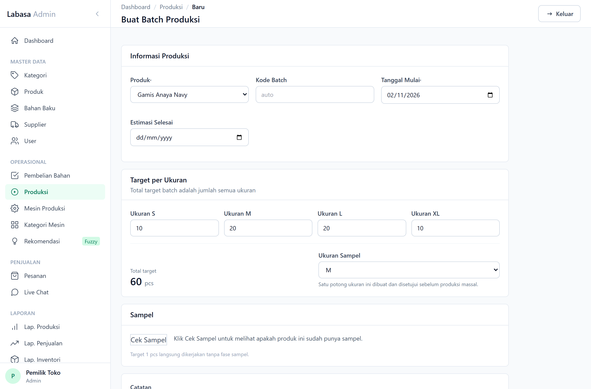

### 2. Klik "Cek Sampel" sebelum menyimpan

Di kartu **Sampel**, klik **Cek Sampel**. Untuk produk yang belum punya sampel akan muncul pesan kuning **"Belum ada sampel. Batch ini akan mulai dari Tahap Sampel."**

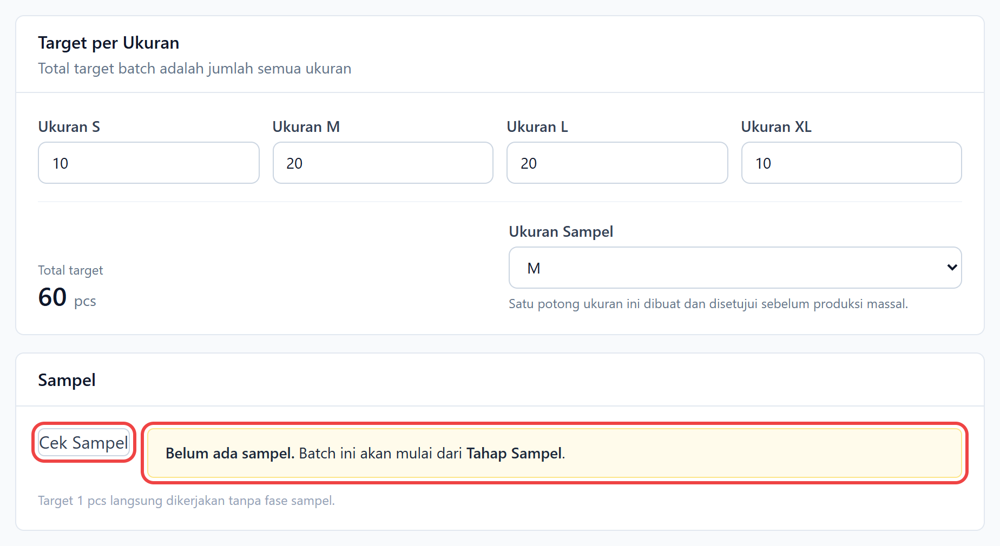

Klik **Mulai Produksi** untuk menyimpan batch.

### 3. Batch punya kartu "Tahap Sampel"

Di halaman batch muncul tiga kelompok tahap: **Persiapan** (Desain dan Pola), **Tahap Sampel**, dan **Produksi Massal**. Produksi Massal **terkunci sampai sampel disetujui**.

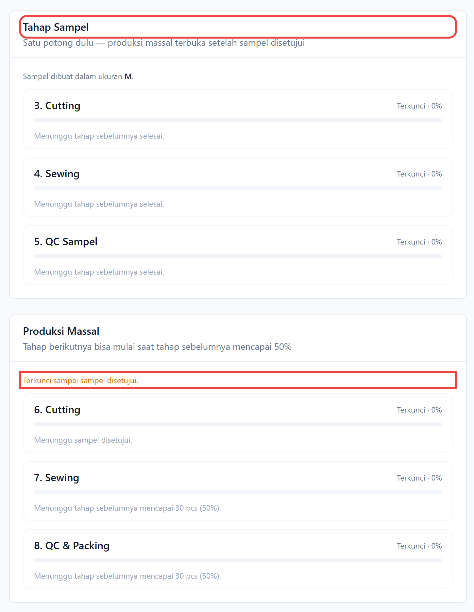

Kerjakan tahapnya berurutan: Desain (upload sketsa) → Pembuatan Pola → Cutting, Sewing, dan QC Sampel (masing-masing 1 pcs).

### 4. Setujui sampel

Setelah **QC Sampel** selesai, muncul dua tombol di bawahnya:

- **Sampel disetujui**: membuka Produksi Massal.
- **Perlu revisi**: isi dulu catatan revisinya. Tahap sampel diulang, dan bahan untuk sampel revisi ikut dihitung.

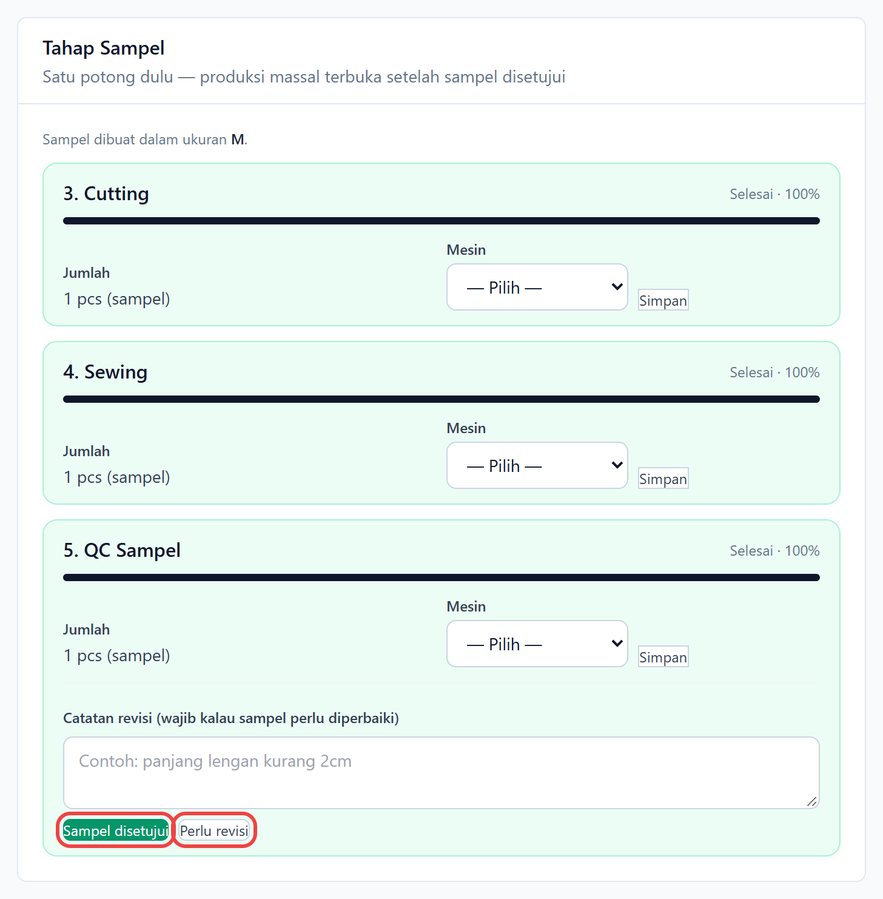

Setelah disetujui, status Sampel di **Informasi Batch** berubah menjadi **Disetujui**. Mulai saat ini produk tersebut **sudah punya sampel** untuk batch-batch berikutnya.

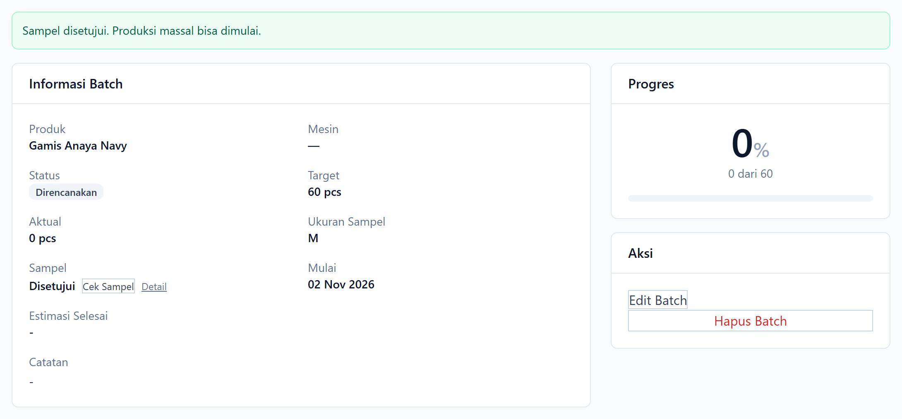

---

## Bagian B — Produk yang sudah punya sampel

### 1. Buat batch baru dan klik "Cek Sampel"

Isi form seperti biasa, lalu klik **Cek Sampel**. Muncul pesan hijau **"Sudah ada sampel dari PRD-…"** beserta foto desain dari batch sampel tersebut. Kode batch-nya bisa diklik untuk membuka batch asal sampel.

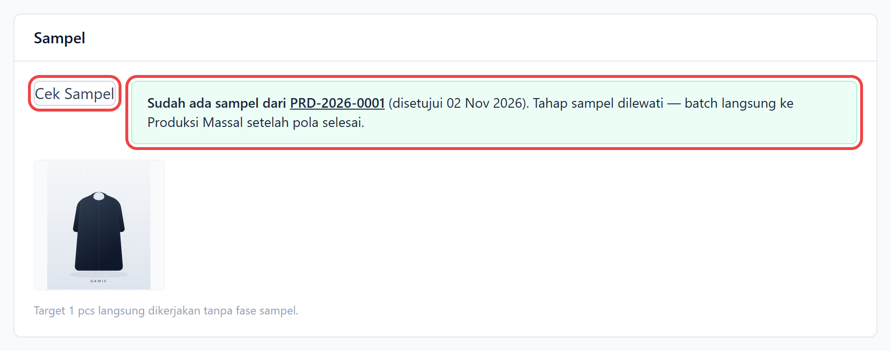

Klik **Mulai Produksi**.

### 2. Batch langsung memakai sampel yang ada

Setelah batch disimpan:

- Muncul pesan **"Batch produksi dibuat. Memakai sampel dari PRD-…"**.
- Di **Informasi Batch**, kolom **Sampel** berisi **"Pakai sampel PRD-…"**.

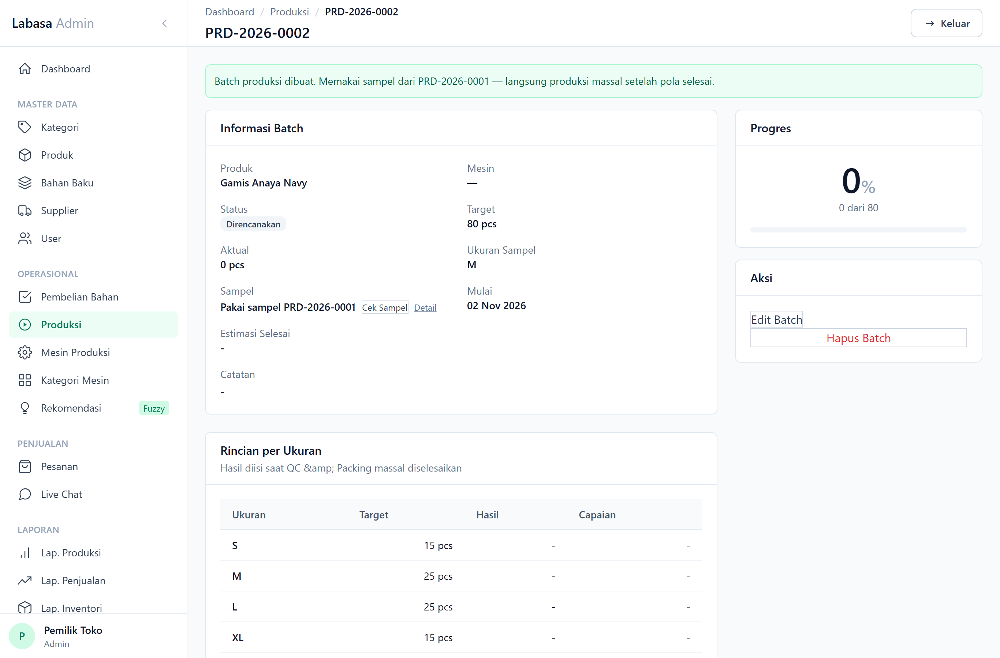

### 3. Tidak ada kartu "Persiapan" dan "Tahap Sampel"

Batch hanya berisi **Produksi Massal** (Cutting → Sewing → QC & Packing). **Cutting** massal langsung bisa dimulai, tanpa Desain, Pola, maupun sampel lagi. Di kartu Produksi Massal tertulis **"Desain dan pola mengikuti sampel PRD-…"** dengan tautan ke batch sampelnya. Bahan untuk sampel juga tidak dihitung di "Bahan Terpakai".

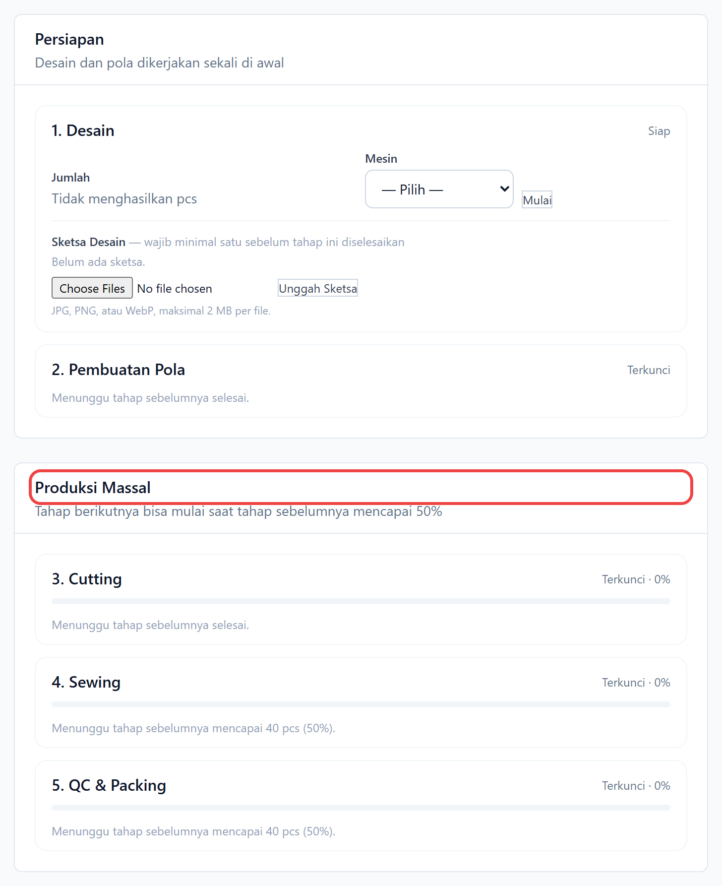

---

## Bagian C — Batch lama yang masih punya Tahap Sampel

Batch yang dibuat sebelum produknya punya sampel tetap memiliki kartu Tahap Sampel. Kalau sekarang produknya **sudah** punya sampel dari batch lain, tahap sampel batch itu bisa dilewati.

### Cara 1: tombol "Cek Sampel" di Informasi Batch

Klik **Cek Sampel** di samping status Sampel.

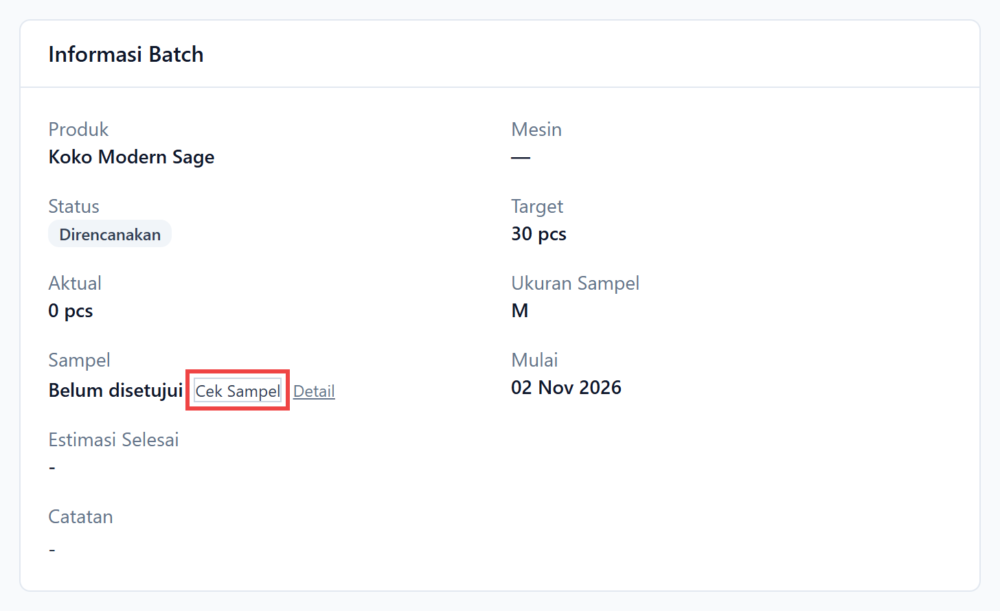

Sistem langsung bertindak sesuai kondisi:

| Kondisi | Hasil |
| --- | --- |
| Produk sudah punya sampel dan tahap sampel batch ini **belum dimulai** | Persiapan dan tahap sampel dihapus, batch pindah ke Produksi Massal |
| Produk belum punya sampel | Diarahkan ke Tahap Sampel |
| Sampel batch ini **sudah mulai dibuat** atau pernah direvisi | Diarahkan untuk melanjutkan di Tahap Sampel (tidak bisa ganti sampel) |

### Cara 2: lewat "Detail"

Klik **Detail** di samping status Sampel untuk melihat info sampel terlebih dahulu, termasuk foto desain dari batch sampel. Lalu klik **Pakai sampel ini, langsung produksi massal**.

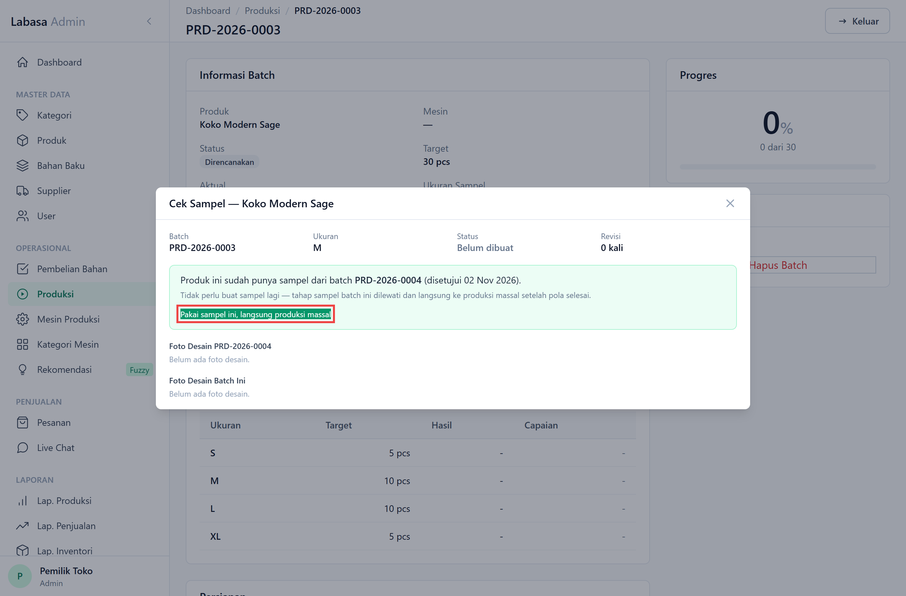

### Hasilnya

Kolom Sampel menjadi **"Pakai sampel PRD-…"**.

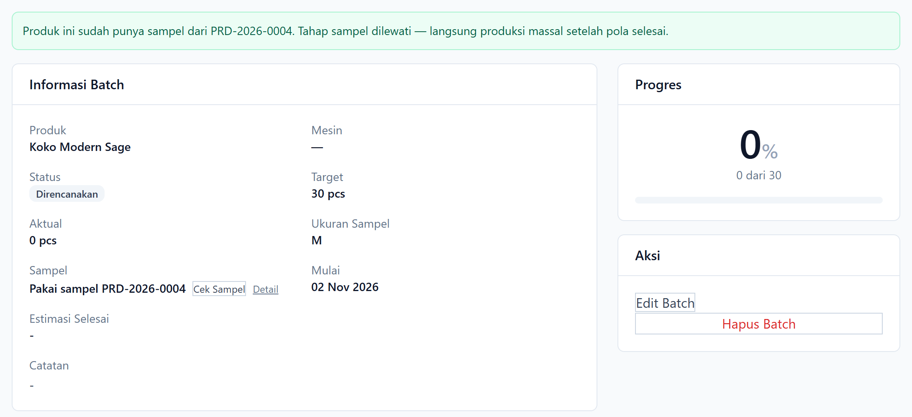

Kartu Persiapan dan Tahap Sampel hilang, urutan tahap dirapatkan kembali: batch langsung mulai dari Cutting massal. Sketsa yang sempat diunggah di batch ini tetap tersimpan, tapi yang dipakai adalah desain batch sampelnya.

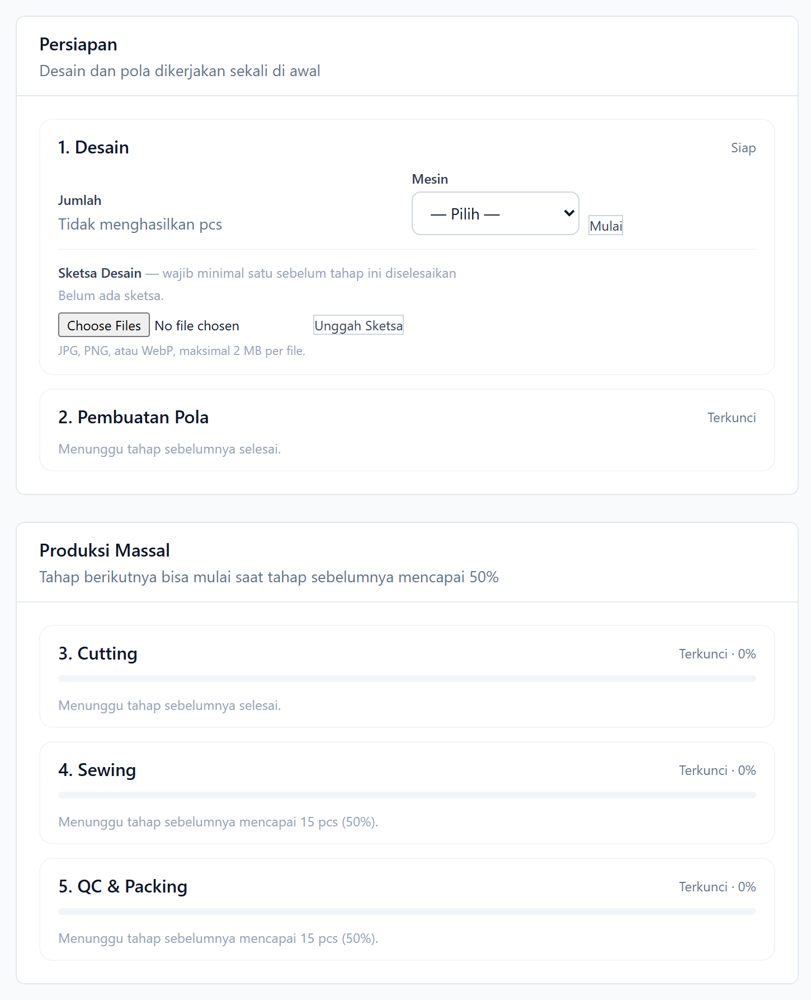

---

## Pertanyaan umum

**Cek Sampel bilang sudah ada sampel, tapi batch tetap punya Tahap Sampel?**
Pastikan aplikasinya sudah versi terbaru dan migrasi sudah dijalankan (`php artisan migrate`). Untuk batch yang terlanjur dibuat dengan Tahap Sampel, buka batch-nya lalu klik **Cek Sampel** (Bagian C).

**Sampel yang masih dalam proses (belum disetujui) di batch lain, apakah dihitung?**
Tidak. Yang dihitung hanya sampel yang sudah **disetujui**, atau batch yang sudah **selesai**.

**Apakah tombol "Cek Sampel" di form wajib diklik?**
Tidak. Tombol itu hanya untuk melihat hasilnya sebelum menyimpan. Saat batch disimpan, sistem tetap mengecek sampel secara otomatis.
